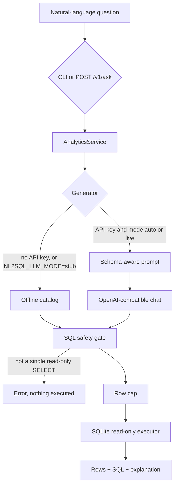

# nl2sql-analytics-agent

Natural-language questions over a small sales warehouse. The agent turns a question into SQL, refuses anything that is not a single read-only query, runs it on SQLite, and returns the rows, the SQL, and a short explanation of the metric.

By default there is **no model and no API key**. A fixed catalog of demo questions maps to hand-written SQL. An optional OpenAI-compatible chat endpoint can be switched on with an environment variable; its SQL goes through the same safety gate.

This is a portfolio project for **Alexandru Cojocari (DatadrivenAlex)**. It shows a junior AI developer path (prompt, tool gate, provider switch, offline eval set) and a data analyst path (grain, metric definitions, a star-style model). It is not a production text-to-SQL system.

## Try the three sample questions

From the repository root:

```bash
python -m venv .venv
source .venv/bin/activate
pip install -e ".[dev]"
nl2sql init-db
nl2sql ask "What were total net sales by region in 2025?"
nl2sql ask "Which product category generated the most revenue?"
nl2sql ask "How many orders did Enterprise customers place?"
```

`python -m nl2sql` is the same CLI. The warehouse file is `data/analytics.sqlite` (gitignored, rebuilt by `init-db`).

On this seed, those three questions come back as:

| Question | Answer |
| --- | --- |
| Net sales by region in 2025 | North 7454.40 (6 orders), South 5550.60 (5), East 4936.20 (3), West 3818.10 (2), EU 1255.00 (2) |
| Top category by revenue | Software 13795.10, then Hardware 12757.85, then Services 8046.00 |
| Enterprise orders placed | 15 orders, 16 order lines |

The order/line gap is order 40, which has two lines. Sales figures are completed lines only, summed in cents and divided by 100.

Equivalent HTTP calls:

```bash
uvicorn nl2sql.api.app:app --host 127.0.0.1 --port 8000
```

```bash
curl -s http://127.0.0.1:8000/health
curl -s http://127.0.0.1:8000/ready
curl -s http://127.0.0.1:8000/v1/schema
curl -s http://127.0.0.1:8000/v1/ask \
  -H 'content-type: application/json' \
  -d '{"question": "What were total net sales by region in 2025?"}'
```

`POST /v1/ask` returns JSON:

| Field | Meaning |
| --- | --- |
| `sql` | Statement that actually ran, after parsing and the row cap |
| `explanation` | Why this metric definition was used |
| `columns`, `rows`, `row_count` | Result table |
| `source` | `stub` or `llm` |
| `truncated` | `true` when the safety cap cut the result |

## Architecture



The question string is never executed. Only generated SQL is, and only after the gate below. The live prompt is grounded in `sqlite_master` plus the metric glossary in `src/nl2sql/warehouse/metrics.py`, not in a hand-copied schema that can drift from the file.

## SQL safety

Defense is layered. Any one layer is imperfect; together they are the point of the project.

1. **Parse, don't keyword-filter.** [sqlglot](https://github.com/tobymao/sqlglot) parses the statement. Exactly one of `SELECT`, `UNION`, `INTERSECT`, `EXCEPT`, or a subquery wrapper is allowed. `INSERT`, `UPDATE`, `DELETE`, `DROP`, `ALTER`, `CREATE`, `REPLACE`, `PRAGMA`, `ATTACH`, and similar commands are rejected. A semicolon or a second statement hidden after a line comment is a different statement, so it is rejected too.
2. **Execute the rendering, not the raw string.** The executor runs sqlglot's rendering of the tree it inspected.
3. **String literals are data.** `WHERE name = 'DROP TABLE ...'` is still a `SELECT`. A keyword block-list would reject that and would also miss obfuscated writes. The allow-list does the opposite.
4. **Side-effect functions** `load_extension`, `writefile`, `readfile`, `edit`, and `fts3_tokenizer` are rejected in the tree and again by SQLite's authorizer.
5. **Row cap.** `NL2SQL_MAX_ROWS` (default 100, ceiling 1000). A missing, non-integer, or negative `LIMIT` is replaced. SQLite treats `LIMIT -1` as unlimited; that bypass is closed.
6. **Read-only connection.** The file is opened with `mode=ro`, then `PRAGMA query_only = ON`.
7. **Authorizer.** Every SQLite action except `SELECT`, `READ`, `RECURSIVE`, and ordinary functions is denied.
8. **Timeout.** A progress handler aborts the statement at `NL2SQL_QUERY_TIMEOUT_S` (default 5 seconds).

There is no authentication. Do not expose the API on a public network. The gate stops writes and multi-statement injection; it does not stop a deliberately expensive `SELECT` beyond the timeout, and it does not make a live model's SQL correct.

## Catalog

The offline matcher lowercases, strips punctuation, and drops "please" / "thanks". It does not fuzzy-match. An unknown question returns the catalog instead of inventing SQL.

| Question | What it measures |
| --- | --- |
| What were total net sales by region in 2025? | Completed net sales, customer region, year from `dim_date` |
| Which product category generated the most revenue? | Categories ranked by completed net sales |
| How many orders did Enterprise customers place? | Distinct orders vs line count, any status |
| Show monthly net sales for 2025 | Completed net sales by month |
| Who are the top 5 customers by net sales? | Completed net sales, top 5 |
| What is the average order value by channel? | Completed net sales / distinct orders |
| Which products have the most returned quantity? | Units with `status = 'returned'` |
| Show quarterly net sales for 2025 | Completed net sales by quarter |
| How many customers signed up in 2024? | `dim_customer.signup_date`, not orders |
| How many products are in each category? | Catalog counts |
| What are net sales by customer segment? | Completed net sales by segment |

Add `--json` for the same object the API returns. `nl2sql schema` prints the live catalog.

## Warehouse

See [docs/schema.md](docs/schema.md) for grain, keys, and metric definitions.

- `dim_date`, `dim_customer`, `dim_product`
- `fact_order_line` at order-line grain, money in integer cents
- `v_order_line` for reading a line with names attached

Net sales means `SUM(net_amount_cents) / 100.0` where `status = 'completed'`.

## Runbook

### Tests

```bash
pip install -e ".[dev]"
pytest
```

The suite does not call the network. Live-model tests use an in-process HTTP mock.

### Configuration

Copy [`.env.example`](.env.example) and export the variables you need. The process does not read `.env` by itself.

| Variable | Default | Role |
| --- | --- | --- |
| `NL2SQL_DB_PATH` | `data/analytics.sqlite` | Warehouse file |
| `NL2SQL_LLM_MODE` | `auto` | `auto`, `stub`, or `live` |
| `NL2SQL_LLM_API_KEY` | empty | Prefer this over `OPENAI_API_KEY` |
| `NL2SQL_LLM_BASE_URL` | `https://api.openai.com/v1` | Chat completions base URL |
| `NL2SQL_LLM_MODEL` | `gpt-4o-mini` | Model name |
| `NL2SQL_LLM_TIMEOUT_S` | `30` | HTTP timeout |
| `NL2SQL_MAX_ROWS` | `100` | Hard cap, max 1000 |
| `NL2SQL_QUERY_TIMEOUT_S` | `5` | SQLite statement budget |

`auto` uses the stub when no key is set. `stub` stays offline even if a key is present. `live` requires a key and sends every question to the model. The client does not follow redirects, and it refuses a key embedded in the URL.

The model must return JSON: `{"sql": "...", "explanation": "..."}`. A fenced JSON object is accepted. The SQL is then validated like any other statement. A model that answers with `DROP` does not drop anything.

### Reset the database

```bash
nl2sql init-db
# or
rm -f data/analytics.sqlite && nl2sql init-db
```

`init-db` replaces the file. The API also creates it on startup when the file is missing.

### Docker

Optional. The image runs as a non-root user with the stub forced on:

```bash
docker compose up --build
```

The API listens on port 8000. Compose sets `NL2SQL_LLM_MODE=stub`.

### CLI exit codes

| Code | Meaning |
| --- | --- |
| 0 | Answer printed |
| 1 | Config, warehouse, or model error |
| 2 | Question is not in the offline catalog |
| 3 | SQL was rejected |
| 4 | Query exceeded the time budget |

`nl2sql serve` binds `127.0.0.1` unless you pass `--host`. The container process binds `0.0.0.0` because it is behind Compose's port publish.

### Troubleshooting

- **Unrecognized question.** You are on the stub. Use a catalog question, or set a key and `NL2SQL_LLM_MODE=auto`.
- **`/ready` returns 503.** The file is missing or not a database. Run `nl2sql init-db --db <path>`.
- **HTTP 400 `unsafe_sql`.** The generator produced a write, several statements, or a blocked function. The warehouse is unchanged.
- **HTTP 408.** The statement hit `NL2SQL_QUERY_TIMEOUT_S`.

## How this maps to the roles

**Junior AI developer**

- Provider switch in `src/nl2sql/agent/pipeline.py`: stub by default, live model only when configured.
- Schema-aware prompt in `src/nl2sql/agent/prompt.py`, built from the live DDL.
- Structured output (`sql`, `explanation`) parsed in `src/nl2sql/agent/llm.py`. Tool use is generate, then validate, then execute. There is no retry loop.
- The catalog in `src/nl2sql/agent/stub.py` is a tiny offline eval set: known questions must return the metric as defined in the warehouse, not a plausible-looking query.
- Failure modes are explicit: unknown question, unsafe SQL, model HTTP error, timeout.

**Data analyst**

- Star-style model, documented grain, and a date spine that includes days with no orders. Details in [docs/schema.md](docs/schema.md).
- Metric layer: net sales, orders vs lines, average order value, returns, signups. Cents are summed before dividing.
- Status is part of the metric. A total that includes cancelled or pending lines is a different question.
- Every answer includes the SQL, so a reviewer can audit the definition instead of trusting the prose.

## Honest limits

- The stub is a lookup table. It will not answer a rephrased question it does not list, and it does not generalize.
- The live path is one prompt and one completion. No schema linking research, no execution feedback, no self-correction, no guard model.
- Wrong but safe SQL still runs. `SELECT` can return a confidently incorrect metric if the model ignores the glossary.
- The database is a 34-line SQLite demo, not a warehouse. Money display uses `REAL` after the cents are summed.
- No auth, no tenants, no row-level security, no audit log.
- The row-cap flag `truncated` is true when a limit was added or lowered and the result filled that cap. A query that naturally returns exactly that many rows can look truncated.
- Not a production text-to-SQL system.

## Layout

```
src/nl2sql/
  agent/     catalog, prompt, optional model, shared ask flow
  api/       FastAPI app
  sql/       parser gate and read-only executor
  warehouse/ schema.sql, seed, live introspection, metric glossary
  cli.py
docs/schema.md
tests/
```

## License

MIT. See [LICENSE](LICENSE).
