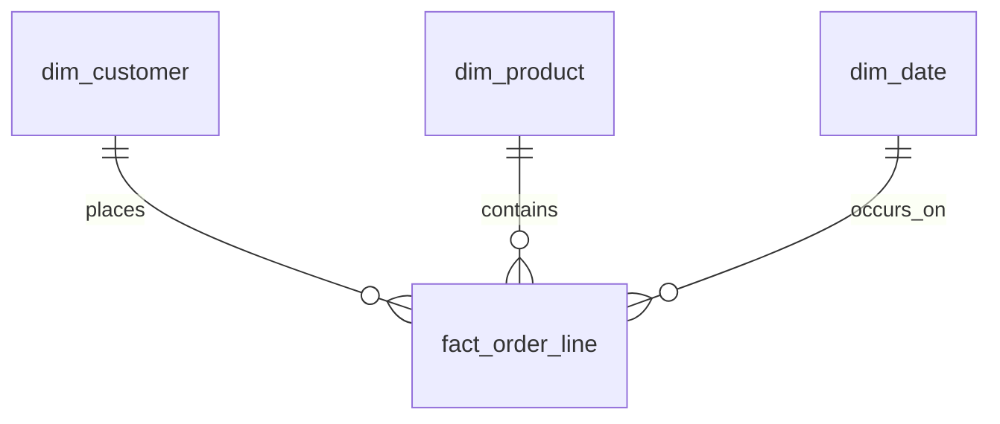

# Demo warehouse schema

SQLite database seeded by `nl2sql init-db`. It is a small star-style model: one fact table at **order line** grain, three dimensions, and a wide view for row-level reading.

This is hand-built demo data (12 customers, 10 products, 34 order lines, a complete date spine). It is large enough to show grain, status filters, and dimensional cuts. It is not a production warehouse.

## Grain and keys

| Object | Grain | Primary key |
| --- | --- | --- |
| `dim_date` | one calendar day | `date_key` (`YYYYMMDD`) |
| `dim_customer` | one customer | `customer_id` |
| `dim_product` | one SKU | `product_id` |
| `fact_order_line` | one order line | `order_line_id` |

`order_id` is not unique. Order 40 has two lines so `COUNT(*)` and `COUNT(DISTINCT order_id)` disagree. Use the distinct order count when the question is about orders.



## Date spine

`dim_date` contains every day from **2022-01-01** through **2025-12-31** (1,461 rows), including days with no orders. That covers both order dates and the customer signup dates in this seed. Signup itself is stored as an ISO string on `dim_customer` (`signup_date`), not as a foreign key.

Columns: `date_key`, `full_date`, `year`, `quarter`, `month`, `month_name`, `day`, `day_name`, `is_weekend`.

## Customer

`segment` is one of `SMB`, `Mid-Market`, `Enterprise`.

`region` is one of `North`, `South`, `East`, `West`, `EU`. Region is a customer attribute. A sale is attributed to the customer's region, not to a shipping address (there is no ship-to in this demo).

Emails use `example.com` and are fake.

## Product

`category` is one of `Hardware`, `Software`, `Services`. `list_price_cents` is the catalog price. The fact table stores the unit price actually used on the line; in this seed that matches the list price, and discounts are applied separately.

## Fact: `fact_order_line`

| Column | Meaning |
| --- | --- |
| `order_line_id` | Surrogate line key |
| `order_id` | Business order id; may repeat |
| `customer_id` | FK to `dim_customer` |
| `product_id` | FK to `dim_product` |
| `date_key` | FK to `dim_date`; the order date |
| `quantity` | Units, always positive |
| `unit_price_cents` | Price per unit before discount |
| `discount_bps` | Line discount in basis points. 1000 = 10%, 10000 = 100% |
| `gross_amount_cents` | `quantity * unit_price_cents` |
| `net_amount_cents` | Gross after discount, half-up to the cent |
| `status` | `completed`, `cancelled`, `returned`, or `pending` |
| `channel` | `web`, `partner`, or `direct` |

Money is **integer cents** so totals reconcile without binary floating-point drift. Convert only after summing:

```sql
ROUND(SUM(net_amount_cents) / 100.0, 2) AS net_sales
```

## Metric definitions

These are the definitions the offline catalog and the model prompt both use.

**Net sales / revenue.** `SUM(net_amount_cents) / 100.0` where `status = 'completed'`. Cancelled, returned, and pending lines are excluded. "Revenue" means net sales unless the question says gross.

**Orders.** `COUNT(DISTINCT order_id)`. Say "order lines" when you mean `COUNT(*)`.

**Average order value.** Completed net sales divided by distinct completed orders. A multi-line order counts once. The catalog breaks this out by `channel`.

**Returned quantity.** `SUM(quantity)` where `status = 'returned'`.

**New customers.** `COUNT(*)` on `dim_customer` whose `signup_date` falls in the window. No order is required.

## View

`v_order_line` joins the fact to all three dimensions and adds display columns (`unit_price`, `discount_pct`, `gross_amount`, `net_amount`) rounded to cents. Those display columns are convenient for reading a line. Do not sum `v_order_line.net_amount` when the figure has to tie back to `net_amount_cents`.

## What the seed is for

The mix is intentional:

- Several regions and all three segments have completed sales, so a regional total is not a single row.
- 2024 and 2025 both have activity. Questions that say "in 2025" must join `dim_date` (or filter `full_date`) rather than summing the whole fact.
- Returned, cancelled, and pending lines exist so a sales total that forgets `status = 'completed'` is wrong.
- One order has two lines so an order count written as `COUNT(*)` is wrong.

Illustrative sales query (the catalog copy lives in `src/nl2sql/agent/stub.py`):

```sql
SELECT
  c.region,
  ROUND(SUM(f.net_amount_cents) / 100.0, 2) AS net_sales,
  COUNT(DISTINCT f.order_id) AS orders
FROM fact_order_line AS f
JOIN dim_customer AS c ON c.customer_id = f.customer_id
JOIN dim_date AS d ON d.date_key = f.date_key
WHERE f.status = 'completed'
  AND d.year = 2025
GROUP BY c.region
ORDER BY net_sales DESC, c.region;
```
